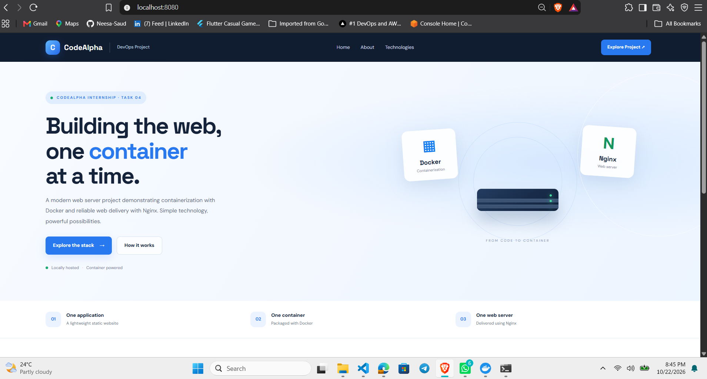
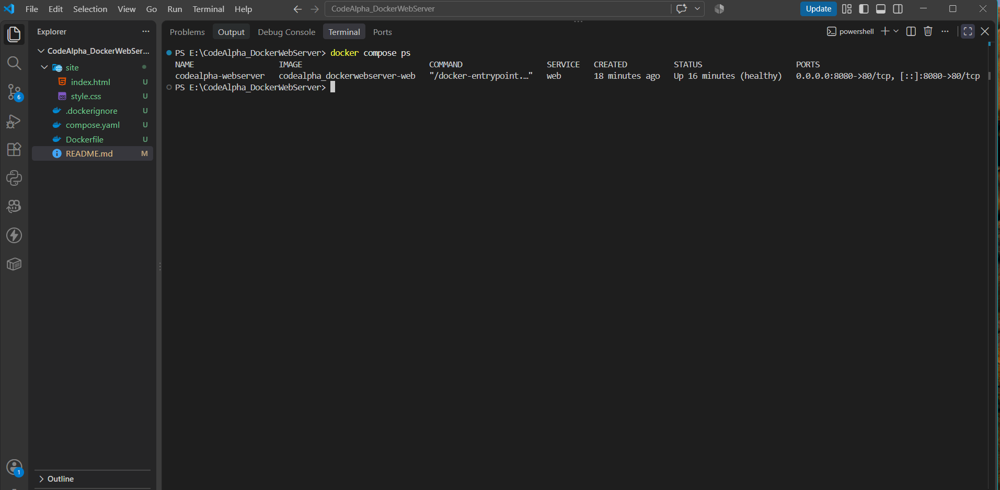

# Docker Web Server

A simple web server project built using Docker and Nginx as part of my CodeAlpha DevOps internship (Task 4).

The project runs a responsive HTML/CSS website inside a Docker container and makes it accessible at `http://localhost:8080`.

## Tech Stack

- Docker
- Docker Compose
- Nginx
- HTML & CSS

## Project Structure

```text
CodeAlpha_DockerWebServer/
├── site/
│   ├── index.html
│   └── style.css
├── screenshots/
│   ├── image.png
│   └── image2.png
├── Dockerfile
├── compose.yaml
├── .dockerignore
└── README.md
```

## Running the Project

Make sure Docker is installed and running.

Clone the repository and open the project folder.

Build and start the container:

```powershell
docker compose up --build -d
```

Open `http://localhost:8080` in your browser.

To check the running container:

```powershell
docker compose ps
```

## Docker Commands

Some commands I used while working on this project:

| Command | Purpose |
|---|---|
| `docker compose up --build -d` | Build the image and start the container |
| `docker compose ps` | Check container status |
| `docker compose logs web` | View Nginx logs |
| `docker compose stop` | Stop the container |
| `docker compose start` | Start the stopped container |
| `docker compose restart` | Restart the container |
| `docker compose down` | Stop and remove the container |

## Health Check

The Compose file includes a health check using `nginx -t` to validate the Nginx configuration.

To check its status:

```powershell
docker inspect --format='{{.State.Health.Status}}' codealpha-webserver
```

To check whether the website responds:

```powershell
curl.exe -I http://localhost:8080
```
## Screenshots

### Website Preview



### Docker Container Status



## What I Learned

While working on this task, I got hands-on experience with:

- Writing a Dockerfile and building an image.
- Running an Nginx web server inside a container.
- Mapping container port 80 to localhost port 8080.
- Managing containers using Docker Compose.
- Checking container logs and fixing configuration errors.

I also ran into issues with the Nginx startup command and the file copy path in the Dockerfile. Checking the container logs helped me identify and fix them.

## About

**CodeAlpha DevOps Internship - Task 4: Web Server using Docker**
